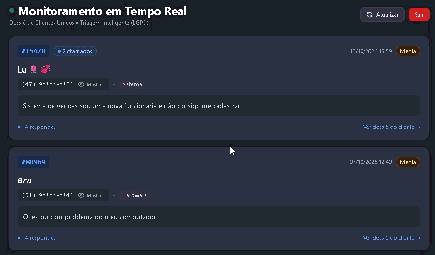

#  Sistema de Triagem e Suporte Inteligente com IA

##  Sobre o Projeto
Este projeto é a base de um Micro-SaaS para gestão de atendimento. Ele recebe mensagens de usuários via WhatsApp, utiliza Inteligência Artificial para interpretar, categorizar e priorizar o problema, gera um protocolo de atendimento e salva os dados de forma estruturada em um banco de dados relacional para consumo analítico (Power BI) e gestão via Dashboard web.

##  Arquitetura e Tecnologias
- **Infraestrutura:** Docker & Docker Compose
- **Orquestração de Fluxos:** n8n (Self-hosted)
- **Inteligência Artificial:** Google Gemini (LLM)
- **Banco de Dados:** PostgreSQL
- **Gateway de Mensagens:** Evolution API (WhatsApp)
- **Túnel de Rede:** Ngrok
- **Análise de Dados:** Power BI
- **Frontend:** HTML/JS com Tailwind CSS (Hospedado via GitHub Pages)

---

## Infraestrutura e Containerização (Docker🐳)
Todo o ecossistema de back-end opera em um ambiente isolado e conteinerizado, gerenciado através do **Docker Compose**. Essa abordagem garante portabilidade, fácil replicação do ambiente em qualquer servidor (Cloud ou On-Premise) e independência de sistema operacional.

Os seguintes serviços rodam simultaneamente na mesma rede lógica (`docker-network`):
1. **Container PostgreSQL:** Hospeda o banco de dados relacional e a memória de contexto (Chat Memory) da Inteligência Artificial.
2. **Container n8n:** Executa a orquestração de dados e APIs na porta `5678`.
3. **Container Evolution API:** Gerencia a sessão do WhatsApp via instâncias locais, conectando-se ao n8n via Webhooks.

---

##  Fluxos de Automação (n8n)

O ecossistema conta com dois fluxos orquestrados no n8n que se dividem entre processamento cognitivo e disponibilização de dados:

1. **Triagem Inteligente com IA (`Fluxo Principal-AI`):**
   - **Gatilho & Filtro:** Recebe o webhook da Evolution API e aplica regra anti-loop (`fromMe`).
   - **Contexto & Decisão:** Extrai os dados, gera protocolo único e aciona o **AI Agent (Google Gemini)** utilizando memória de conversa persistente no PostgreSQL.
   - **Roteamento Dinâmico:** Um nó de *Parse IA* estrutura a decisão da LLM:
     - **Caminho True (Abertura de Chamado):** Persiste o ticket no PostgreSQL (`chamados_suporte`) e envia o comprovante com o protocolo para o WhatsApp.
     - **Caminho False (Conversa/Dúvida):** Responde o usuário no WhatsApp mantendo o histórico sem registrar chamado técnico.

2. **API REST para o Dashboard (`API Chamados`):**
   - Disponibiliza um endpoint HTTP `GET /webhook/chamados` com suporte a CORS para alimentar o painel web (HTML/JS) consumindo os registros mais recentes do banco.

> 📖 **Documentação Técnica Detalhada:**  
> Para consultar a arquitetura completa nó a nó, expressões JavaScript de controle, variáveis absolutas e regras do banco de dados, acesse o arquivo **[WORKFLOW.md](WORKFLOW.md)**.


##  Estrutura do Banco de Dados (PostgreSQL)
A tabela `chamados_suporte` atua como a *Single Source of Truth* (Fonte Única de Verdade) do sistema.

```sql
CREATE TABLE chamados_suporte (
    id SERIAL PRIMARY KEY,
    protocolo VARCHAR(20) UNIQUE NOT NULL,
    telefone_cliente VARCHAR(20),
    nome_cliente VARCHAR(100),
    mensagem_original TEXT,
    categoria VARCHAR(50),
    prioridade VARCHAR(20),
    resposta_ia TEXT,
    data_criacao TIMESTAMP DEFAULT CURRENT_TIMESTAMP
);
```
---

##  Analytics e Business Intelligence (Power BI📊)
O sistema não apenas resolve o fluxo operacional, mas gera inteligência para a tomada de decisão gerencial. Um painel no Power BI foi conectado nativamente ao PostgreSQL (via modo Import/DirectQuery) para consumir a tabela `chamados_suporte`.

**Processo de ETL e Modelagem:**
- Tratamento de tipos de dados (Datas e Textos) via Power Query.
- Criação de medidas em DAX para contagem dinâmica e filtragem de severidade.

**Métricas e KPIs acompanhados no Dashboard:**
- **Volume Geral:** Contagem total de chamados abertos.
- **Distribuição por Categoria:** Gráficos mostrando quais áreas (Sistema, Hardware, Dúvida) demandam mais esforço do suporte.


##  Painel de Chamados (Frontend)

O Painel de Chamados é a interface administrativa web projetada para o Nível 1 de suporte. Desenvolvida focando em velocidade, clareza e conformidade com a LGPD.

###  Tecnologias Utilizadas
- **HTML5 & Vanilla JavaScript:** Estrutura leve sem necessidade de frameworks pesados para garantir performance e facilidade de deploy.
- **Tailwind CSS:** Utilizado via CDN para estilização responsiva, componentes modulares e design system consistente.
- **Hospedagem:** GitHub Pages, configurado para consumir dados via requisição de uma origem externa (Ngrok) através da configuração de CORS.

###  Funcionalidades Principais e UX
- **Consumo de API Dinâmica:** Realiza requisições assíncronas ao endpoint do n8n para atualizar a lista de chamados, garantindo uma interface fluida.
- **Conformidade com a LGPD (Data Masking):** 
  - Todos os números de telefone (dados sensíveis) são carregados do banco de dados e imediatamente mascarados no frontend via JavaScript.
  - Implementado um "Toggle Button" (ícone de olho) que permite ao atendente revelar temporariamente o número apenas quando estritamente necessário para o contato, garantindo a privacidade do cliente (*Privacy by Default*).
- **Agrupamento Inteligente (Group By):** A interface processa o array de dados e agrupa os tickets por cliente. A tela inicial (lista principal) exibe apenas o chamado mais recente e urgente de cada usuário, evitando poluição visual.
- **Sistema de Modal (Dossiê do Cliente):**
  - Ao clicar em um ticket, um modal em overlay é aberto.
  - O modal é dividido em 3 áreas funcionais para agilizar o atendimento: Detalhes do Usuário/Problema, Resposta Gerada pela IA e Ações Rápidas.
  - O modal também renderiza, na parte inferior, o **Histórico Completo** do cliente, listando todos os chamados anteriores abertos por aquele mesmo número, permitindo que o atendente compreenda as recorrências.
 


---

## 📂 Arquivos do Projeto
Para facilitar a avaliação técnica e reprodução do ambiente, os arquivos originais estão disponíveis na pasta `assets`:
- **Fluxos de Automação:** 
  - [📁 Workflow 1: Triagem Inteligente (IA)](assets/FluxoPrincipal-IA.json)
  - [📁 Workflow 2: API do Dashboard](assets/API_Dashboard.json)
- **Analytics:** 
  - [📊 Dashboard Power BI - Gestão de Chamados](assets/PROJETO_TICKET.pbix)
